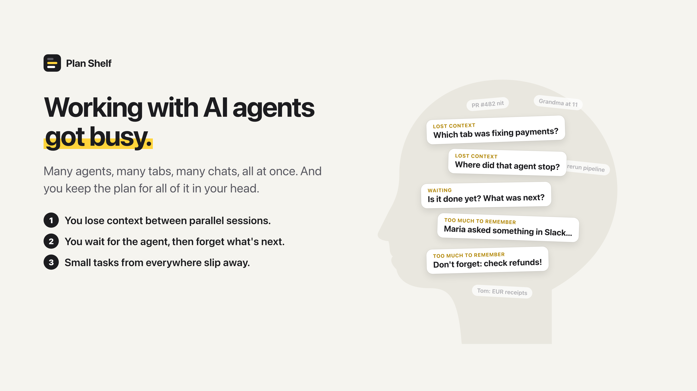
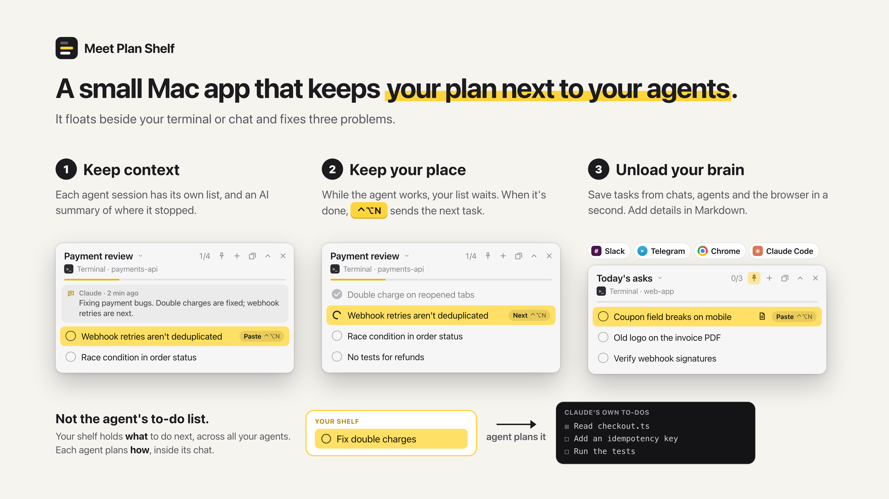
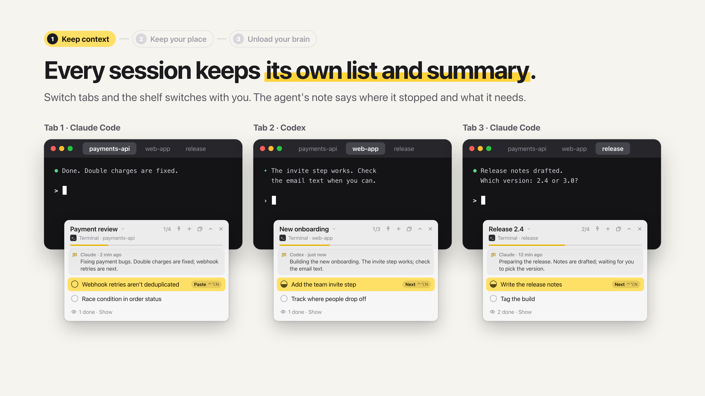
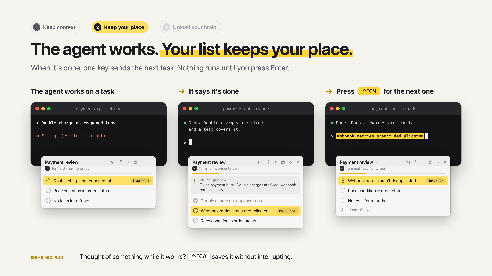
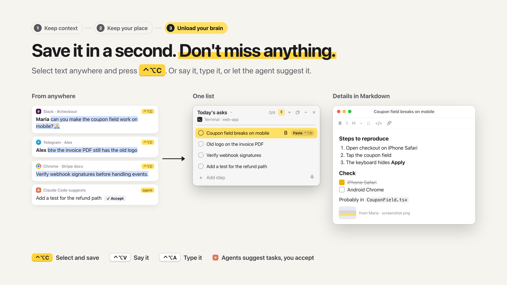
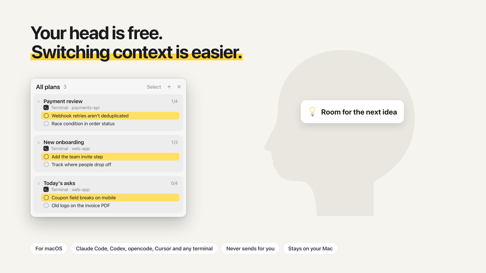

# Plan Shelf

**Your plan, next to your agents.** A small Mac app that keeps track of what's next while Claude Code, Codex and your chats do the work.

Running several agents at once is fast, until you're the one holding the plan in your head. Which tab was fixing payments? Where did that agent stop? What was next? And someone just asked you something in Slack.

Plan Shelf is a small checklist that floats beside your terminal or chat. It fixes three things:

1. **Keep context.** Every agent session has its own list, plus a short summary of where the agent stopped.
2. **Keep your place.** While the agent works, your list waits. When it's done, one key sends the next task.
3. **Unload your brain.** Save a task from any app in a second, and add details in Markdown.

## Every session keeps its own list

Switch tabs and the shelf switches with you. Each terminal tab, Zed thread or chat has its own plan, and the agent leaves a note: what it did and what it needs from you.

## One key for the next task

The agent finishes, and you press **⌃⌥N**. The next task is pasted into the agent's prompt, and the one before is checked off. Nothing runs until you press Enter.

Thought of something while it works? **⌃⌥A** saves it without interrupting.

## Save it in a second

Select text anywhere and press **⌃⌥C**: a Slack message, a Telegram note, a line in the docs. Or say it with **⌃⌥V**, or type it with **⌃⌥A**. Agents can suggest tasks too; nothing joins your list until you accept it.

Each task can hold a description in Markdown, with screenshots and files. Agents get it along with the task.

## Your head is free

All your plans in one view: what each one is on, and what comes next.

## Good to know

- **Works with** Claude Code, Codex, opencode, Cursor, Zed and any terminal. Agents read your plan and mark tasks done through MCP; Claude Code and Codex can also report progress by themselves.
- **Never presses Enter for you**, unless you turn on Send.
- **Stays on your Mac.** Plans are a file on your disk. Voice is recognized on your Mac.
- **Updates itself.** New versions arrive in the app; you choose when to install.

## Download

Get the latest version from [**Releases**](https://github.com/AlexChuv/plan-shelf-releases/releases/latest): download the zip, unzip it, and move **Plan Shelf** to Applications. Needs macOS 14 or later.

Current builds aren't notarized by Apple yet. The first time, macOS blocks the app: open **System Settings → Privacy & Security** and click **Open Anyway**. Later updates install without this.

On first launch, Plan Shelf asks for **Accessibility**, so it can read the text you select and paste tasks. Without it, it still works through the clipboard.
